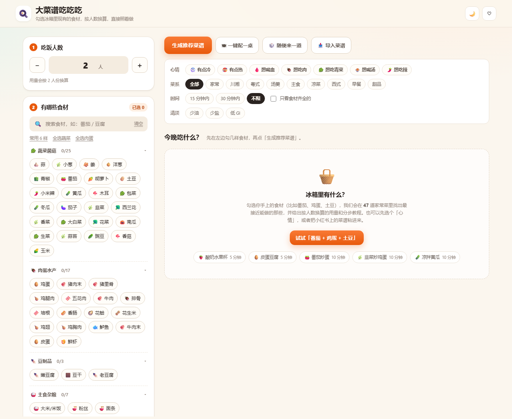
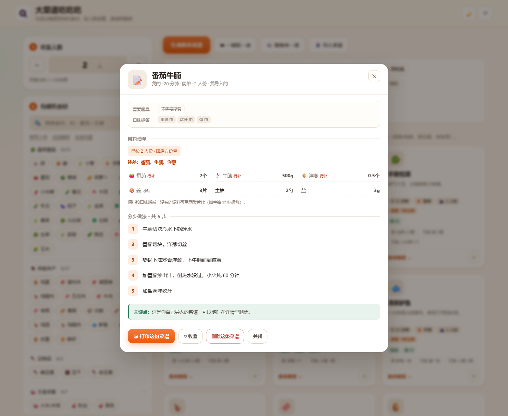

# 大菜谱吃吃吃 · 勾选食材，生成今晚的菜

🌐 在线版：https://nijikiru.github.io/recipe-studio/

一个纯前端的小网站：**勾选冰箱里现有的食材 → 填上吃饭人数 → 立刻得到能照着做的菜谱教程**，所有用量自动按人数换算；厨具和常备调味料只要设置一次就会长期记住。



## 打开方式

**方式一（最省事）**：直接双击 `index.html`，用浏览器打开即可，不需要联网、不需要安装任何东西。

**方式二（本地服务，推荐用于手机预览）**：

```powershell
node server.mjs 5178
# 浏览器打开 http://127.0.0.1:5178
```

## 怎么用

### 每次都要做的两步

1. **填写人数**：左上角 `−` / `＋` 或直接输入，1–12 人。改人数后所有菜谱的用料会实时重新换算。
2. **勾选食材**：按「蔬菜菌菇 / 肉蛋水产 / 豆制品 / 主食杂粮 / 奶类水果 / 我的食材」分类，支持搜索；也可以用「常用 6 样」「全选蔬菜」「全选肉蛋」快速勾选。
   > 食材是**一次性的**：关掉页面再打开会清空，明天的冰箱和今天的本来就不一样。

### 只需设置一次（长期保存）

3. **厨房装备**：炒锅、平底锅、汤锅、奶锅、蒸锅、电饭煲、高压锅、烤箱、空气炸锅、料理机。**家里没有的不要勾**，需要它的菜会自动从推荐里排除，并提示「已排除 N 道缺厨具（…）」。
4. **常备调味料**：25 种（油盐糖、生抽老抽、香醋料酒、蚝油豆瓣酱、花椒干辣椒、咖喱块、蒸鱼豉油……）。默认**全部当作家里有**，缺哪样取消勾选，需要它的菜同样会被排除。

> 这两项存在浏览器 `localStorage` 里，换页面、关浏览器都还在；「我都有 / 全部都有 / 都没有」可以一键批量设置。

### 先选心情，再选菜

「心情」在「菜系」上方，一次选一个，点第二次取消：

| 心情 | 会推荐什么 |
| --- | --- |
| 🥶 有点冷 | 汤、炖菜、砂锅、咖喱、一锅出这类热乎的 |
| 🥵 有点热 | 凉菜、清蒸、白灼、清淡的 |
| 🩸 想喝血 | 有红肉（牛/猪/羊、排骨、五花、肉末）的菜 |
| 🍖 想吃肉 | 任意含肉的菜 |
| 🥬 想吃青菜 | 主料全是蔬菜或豆制品的菜 |
| 🍲 想喝汤 | 汤羹类 |
| 🌶️ 想吃辣 | 带辣味标签，或用到辣椒/豆瓣酱/花椒/辣酱的菜 |

心情可以和食材、菜系、时间、清淡筛选叠加使用。

### 看结果

- 点 **「生成推荐菜谱」**：按「主料凑齐程度」排序，卡片上的圆环是匹配度（没勾食材时不显示圆环）：
  - 绿色 100% = 主料齐全，可以直接做；
  - 橙色 = 还差点东西，卡片会标出「还差 1 样主料」和具体缺哪样。
- **健康筛选**：每道菜都标了「用油 / 盐分 / GI」的 低·中·高，卡片上只显示值得注意的标签（低油、低盐、低 GI 绿色；高油、高盐、高 GI 橙色）；顶部勾「少油 / 少盐 / 低 GI」即可只看符合的菜。
- **看教程**：点卡片或「查看教程 →」，弹窗里有按人数换算好的用料、需要哪些厨具、分步做法、关键点，可收藏、可直接打印。
- **一键配一桌**：自动配「一荤 + 一素 + 一汤」，避免重复用同一种主料。
- 顶部 ♡ 是「只看收藏」，🌙/☀️ 切换**暖棕色**夜间模式。

> 葱、姜、蒜、小米辣、香菜算「可缺」的增香配料：没有也能做，不会被算成「还差」，所以番茄 + 鸡蛋就能拿到 100%。

## 导入自己的菜谱

点右上「📥 导入菜谱」，把小红书 / 下厨房 / 微信群里的文案整段粘进来，点「解析并保存」：

```
番茄牛腩

材料：番茄2个、牛腩500g、洋葱半个、姜3片、生抽2勺、盐3g

做法：
1. 牛腩切块冷水下锅焯水，撇去浮沫捞出
2. 番茄切块，洋葱切丝
3. 热锅下油炒香洋葱，下牛腩煎到微黄
4. 加番茄炒出汁，倒热水没过，小火炖 60 分钟
5. 加盐和生抽调味，收汁出锅
```

解析规则：

- 第一行 → 菜名
- 「材料 / 食材 / 用料 / 配料」下的内容，按顿号、逗号拆成食材，支持 `2个`、`500g`、`2勺`、`半个`、`200 克`
- 认出是盐、生抽、料酒这类 → 归到调料，不占主料
- 认不出的食材会自动新建一个「我的食材」分类项，勾选面板里立刻能勾
- 「做法 / 步骤 / 制作」下每行 → 一步（自动去掉 `1.` `-` 之类编号）

导入的菜谱存在本地，参与所有筛选与人数换算，详情页里可以删掉（点两次确认）。



## 内置内容

- **47 道家常菜**：番茄炒蛋、麻婆豆腐、宫保鸡丁、红烧肉、地三鲜、回锅肉、清蒸鲈鱼、咖喱鸡饭、土豆炖牛肉、番茄肉酱意面、酸辣汤、香煎鸡胸配时蔬……涵盖家常 / 川湘 / 粤式 / 汤羹 / 主食 / 凉菜 / 西式 / 早餐 / 甜品。
- **58 种食材**、**10 种厨具**、**25 种常备调味料**。
- 每道菜都带：主料用量（按 2 人份）、调料用量、4–6 步做法、一条「关键点」、需要的厨具（支持「任选其一」，如蒸锅或炒锅+蒸架）、用油/盐分/GI 三个健康等级。
- **按人数换算**：`目标人数 / 原方人数` 等比缩放，并做取整（如 1.5 个蛋、600g 米）。

## 加自己的菜谱（改代码）

1. 打开 `data/recipes.js`，照着现有条目往 `RECIPES` 数组里加；新用到的食材在 `INGREDIENTS` 里登记（`cat` 决定它出现在哪个分类下）。
2. 打开 `data/requirements.js`，在 `RECIPE_META` 里补上厨具和健康等级：

```js
{
  id: 'your-dish',
  name: '菜名', emoji: '🍲',
  desc: '一句话介绍', cuisine: '家常', time: 20, difficulty: '简单',
  base: 2,                 // 原方几人份
  tags: ['下饭'],
  mains: [{ id: 'tomato', q: 2, unit: '个' }],     // 主料（q 按 base 人份）
  seasonings: [{ name: '盐', q: 3, unit: 'g' }],   // 调料，会自动对应到常备调料清单
  steps: ['第一步……', '第二步……'],
  tip: '关键点',
}
```

```js
// data/requirements.js
'your-dish': {
  gear: [['wok']],                       // 内层数组表示任选其一，如 [['oven', 'air-fryer']]
  health: { oil: '低', salt: '中', gi: '低' },
},
```

漏写 `RECIPE_META` 也不会崩：默认当成「不需要特殊厨具、油盐 GI 都是中」。

> 只是偶尔加一两道菜的话，直接用「导入菜谱」更省事。

## 文件结构

```
recipe-studio/
├── index.html              # 页面结构
├── styles.css              # 样式（含深夜蓝紫夜间模式 / 响应式 / 打印样式）
├── app.js                  # 勾选、匹配打分、人数换算、厨具调料过滤、心情筛选、导入、弹窗、收藏
├── data/recipes.js         # 47 道菜 + 58 种食材
├── data/requirements.js    # 厨具 / 调料目录 + 每道菜的厨具需求与油盐 GI 等级
├── server.mjs              # 零依赖本地静态服务器
└── .shots/                 # 截图
```

> 开发用的无头浏览器自检脚本（`tools/shot.mjs`）和部署脚本（`tools/deploy.mjs`）只在本地保留，没有上传到仓库。

## 说明

- 收藏、人数、厨具、调味料、导入的菜谱保存在浏览器 `localStorage`，不上传任何数据。
- 打印只输出菜谱详情本身，不会把页面导航打印进去。
